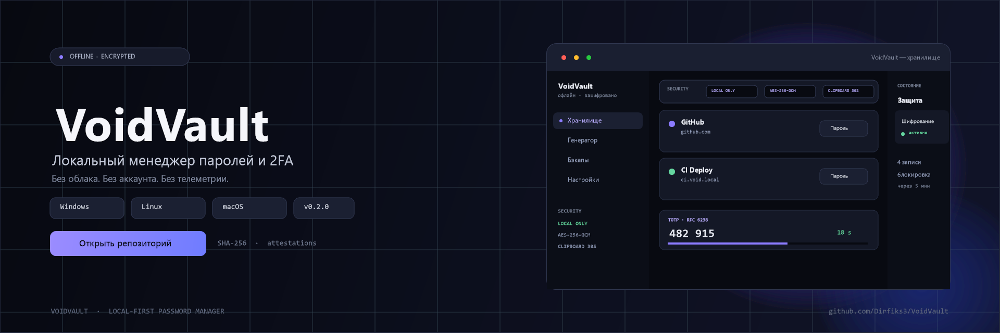
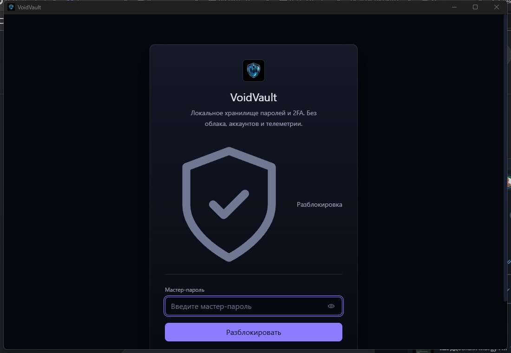
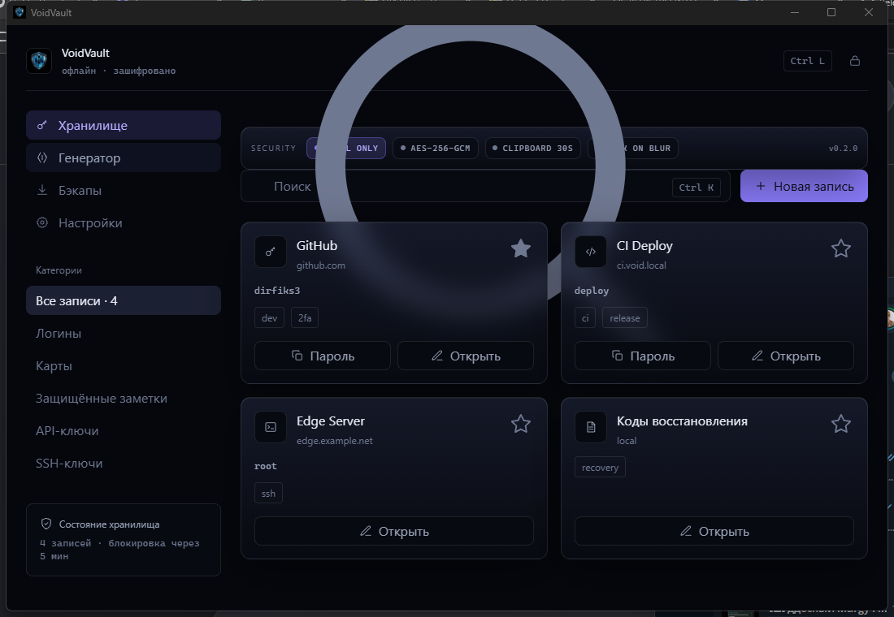
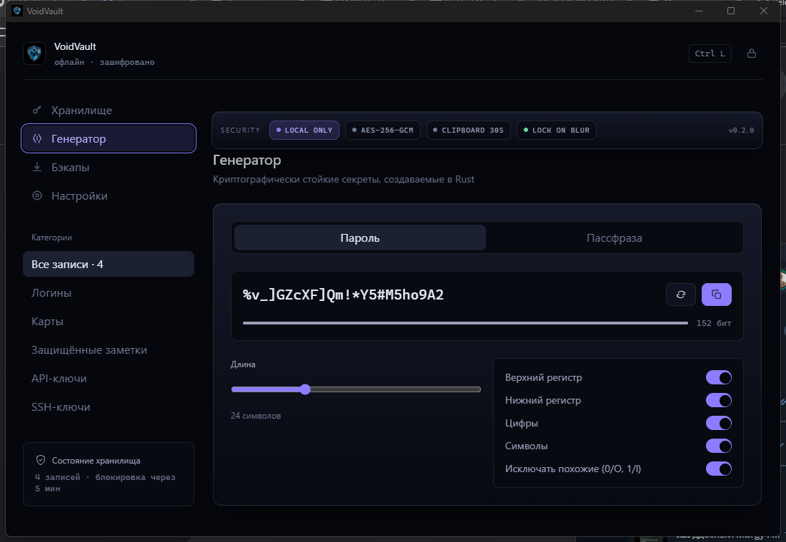
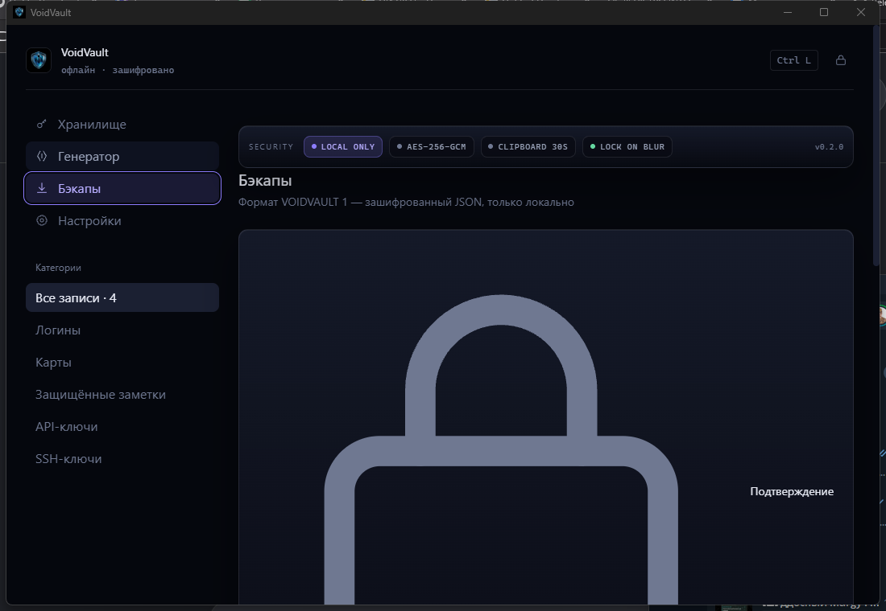
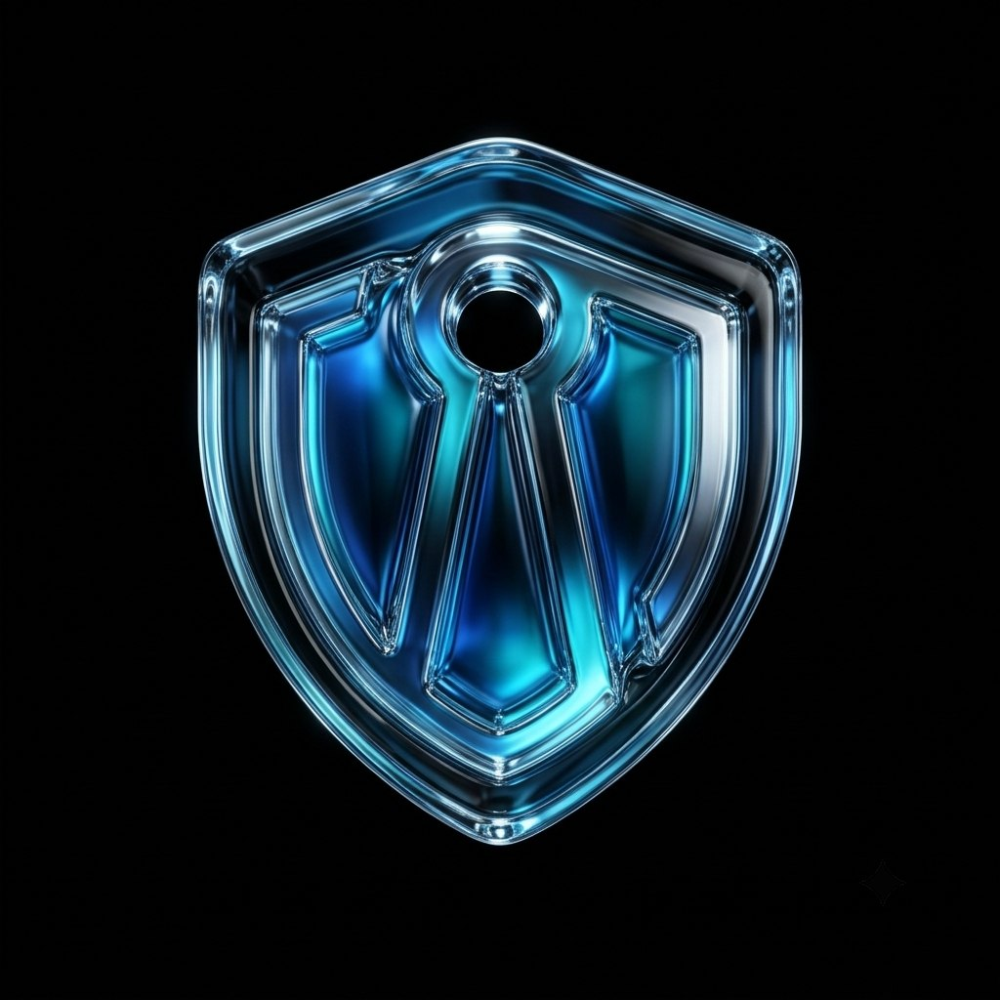

<div align="center">
  
</div>

<p align="center">
  <a href="https://github.com/Dirfiks3/VoidVault/releases/latest"></a>
  
  
  
  
  
  
</p>

<p align="center">
  <a href="#download"><b>Скачать</b></a> &nbsp;·&nbsp;
  <a href="#features"><b>Возможности</b></a> &nbsp;·&nbsp;
  <a href="#backups"><b>Бэкапы</b></a> &nbsp;·&nbsp;
  <a href="#security"><b>Безопасность</b></a> &nbsp;·&nbsp;
  <a href="#stack"><b>Стек</b></a> &nbsp;·&nbsp;
  <a href="#develop"><b>Разработка</b></a>
</p>

---

## Download

Готовые сборки — в [последнем релизе](https://github.com/Dirfiks3/VoidVault/releases/latest).
Все бинарники release, без облака, аккаунтов, синхронизации и телеметрии.

| Платформа | Файл | Что это |
|---|---|---|
| **Windows** | [VoidVault_0.2.0_x64-setup.exe](https://github.com/Dirfiks3/VoidVault/releases/download/v0.2.0/VoidVault_0.2.0_x64-setup.exe) | Установщик NSIS — рекомендуемый вариант |
| **Windows** | [VoidVault_0.2.0_x64_en-US.msi](https://github.com/Dirfiks3/VoidVault/releases/download/v0.2.0/VoidVault_0.2.0_x64_en-US.msi) | MSI-установщик |
| **Linux** | [VoidVault_0.2.0_amd64.AppImage](https://github.com/Dirfiks3/VoidVault/releases/download/v0.2.0/VoidVault_0.2.0_amd64.AppImage) | Portable AppImage, x86_64 |
| **Linux** | [VoidVault_0.2.0_amd64.deb](https://github.com/Dirfiks3/VoidVault/releases/download/v0.2.0/VoidVault_0.2.0_amd64.deb) | Пакет DEB для Debian/Ubuntu |
| **Linux** | [VoidVault-0.2.0-1.x86_64.rpm](https://github.com/Dirfiks3/VoidVault/releases/download/v0.2.0/VoidVault-0.2.0-1.x86_64.rpm) | Пакет RPM для RHEL-семейства |
| **macOS** | [VoidVault_0.2.0_aarch64.dmg](https://github.com/Dirfiks3/VoidVault/releases/download/v0.2.0/VoidVault_0.2.0_aarch64.dmg) | DMG для Apple Silicon |
| **Android** | Сборка из исходников | Публичного APK нет: keystore и пароль остаются на машине сборщика |
| **Исходники** | [v0.2.0.zip](https://github.com/Dirfiks3/VoidVault/archive/refs/tags/v0.2.0.zip) | Чистый проект без `node_modules`, `target` и секретов |

SHA-256 всех файлов опубликован в `SHA256SUMS-*.txt` в [релизе](https://github.com/Dirfiks3/VoidVault/releases/tag/v0.2.0) и сверен с загруженными ассетами.

> Подпись кода Windows сейчас отсутствует: для неё нужен OV/EV-сертификат. Это честно задокументированная оговорка, а не скрытый механизм защиты.
>
> На Android интерфейс учитывает safe-area: панель поиска и категории не перекрываются системными часами, вырезом и кнопками навигации.

---

## Features

Офлайн-менеджер паролей и 2FA: секреты живут только в локальной SQLite-базе, а мастер-ключ — только в памяти Rust. **Основная логика на Rust** (~2610 строк против ~2000 TypeScript/TSX).

| | | |
|:---:|---|---|
| ◉ | **Записи и категории** | Логины, карты, защищённые заметки, API-ключи, SSH-ключи; избранное, теги и заметки. |
| ⌕ | **Поиск и фильтры** | Мгновенный поиск, категории, избранное; фильтрация и сортировка выполняются в Rust. |
| ✦ | **Генератор** | Пароли и пассфразы, энтропия, исключение похожих символов. |
| ◷ | **TOTP 2FA** | RFC 6238 считается в Rust; живой индикатор на 30 секунд. |
| ⇄ | **Бэкапы** | Свой текстовый формат `VOIDVAULT 1`, режимы «Объединить» / «Заменить всё». |
| ⧉ | **Буфер обмена** | Копирование секретов с автоматической очисткой через 30 секунд. |
| ◐ | **Блокировки** | Потеря фокуса, скрытие окна, таймер 1/5/15 минут, горячие клавиши и лимит попыток. |
| ◼ | **Внешний вид** | AMOLED-чёрный монохромный интерфейс с безопасными отступами для Android. |

### Скриншоты

| | |
|:---:|:---:|
|  |  |
|  |  |

### Надёжность

- Мастер-ключ выводится через Argon2id (`64 MiB`, `3` итерации, `parallelism 4`), живёт только в Rust, фиксируется через `mlock` / `VirtualLock` и обнуляется при блокировке.
- Каждое чувствительное поле шифруется отдельно AES-256-GCM; AAD привязывает шифротекст к ID записи и имени поля.
- SQLite лежит в `app.path().app_data_dir()`. Сетевого плагина нет, внешние адреса в CSP запрещены.
- 46 автоматических тестов Rust, включая `source_hygiene`, который не даёт случайно закоммитить ключеподобный литерал.

---

## Backups

Формат экспорта — обычный текст:

```text
VOIDVAULT 1
<base64 с зашифрованным JSON-конвертом>
```

Конверт содержит параметры KDF и полезную нагрузку, зашифрованную текущим ключом хранилища. Внутри — все зашифрованные поля записей, верификатор и настройка автоблокировки.

- **Объединить** — добавляются новые ID, существующие ID остаются как есть.
- **Заменить всё** — текущие записи удаляются перед импортом; секреты из бэкапа перешифровываются ключом текущего хранилища.
- Если бэкап сделан под другим мастер-паролем, его нужно ввести в поле «Пароль бэкапа».
- Экспорт и импорт требуют повторного ввода мастер-пароля. Разрешение живёт 120 секунд только в Rust и отзывается при блокировке.

---

## Security

Открытый код означает, что любые frontend-проверки обходимы патчем. Безопасность держится не на скрытности, а на мастер-ключе и границах, которые навязывает ОС.

| Угроза | Что делает злоумышленник | Что делает VoidVault |
| --- | --- | --- |
| Стиллер | Читает файлы, буфер обмена, базы браузеров | Нет браузерного хранилища и облака; каждое поле шифруется отдельно; буфер очищается через 30 с и при автоблокировке; мастер-ключ не покидает Rust |
| RAT с правами пользователя | Читает память процесса, перехватывает клавиатуру, внедряется в webview | Само приложение эту угрозу не останавливает. Граница здесь — ОС: не работать под администратором, Secure Boot + HVCI + Credential Guard, Defender/EDR |
| RAT с правами администратора или ядра | Полный контроль над машиной | Не помогает ничего. Если машина скомпрометирована на этом уровне, секреты доступны злоумышленнику |
| Подмена бинарника — главная угроза опенсорса | Форк репозитория, троян под видом официального релиза | Сборка в GitHub Actions, аттестации происхождения, `SHA256SUMS`, проверка хэша перед установкой |

### Что реально реализовано

- Верификатор сравнивается в constant-time; неудачные попытки разблокировки и подтверждения бэкапа получают экспоненциальную задержку.
- Перед очисткой буфера через 30 секунд Rust constant-time сверяет текущее содержимое с исходным секретом: чужие данные, скопированные после нас, не стираются.
- Автоблокировка тоже очищает буфер обмена в Rust, даже если фронтенд уже закрыт.
- Оценка сложности пароля, фильтрация, сортировка и автоблокировка выполняются в Rust. Фронтенд получает уже готовые данные.
- Строгий CSP: `connect-src` разрешает только IPC; `object-src`, `base-uri`, `frame-src` и `form-action` равны `'none'`. Devtools отключены, глобальный мост `window.__TAURI__` не предоставляется.
- Capabilities ограничены: `core:default`, запись и очистка буфера, диалоги открытия и сохранения.

### Чего намеренно нет

`IsDebuggerPresent`, anti-VM, тайминговые ловушки и прочая обфускация. В открытом коде это задержка на десять минут, а не защита. Мы не выдаём её за безопасность.

### Проверка сборки

1. Скачай установщик и соответствующий `SHA256SUMS-*.txt` из [релиза](https://github.com/Dirfiks3/VoidVault/releases/tag/v0.2.0).
2. Сверь хэш, например:

   ```powershell
   Get-FileHash .\VoidVault_0.2.0_x64-setup.exe -Algorithm SHA256
   ```

3. В [Actions](https://github.com/Dirfiks3/VoidVault/actions/runs/45467967708) проверь attestation: бинарник должен быть собран из того же коммита, что и релиз.

Не используй административную учётную запись для ежедневной работы. Включай Secure Boot, HVCI и Credential Guard в Windows. Если на машине уже есть RAT с правами ядра, никакое приложение не спасёт секреты.

---

## Stack

- **Tauri v2** + **Rust** — нативное окно, локальная SQLite через `rusqlite` (bundled), `argon2`, `aes-gcm`, `subtle`.
- **React 19** + **TypeScript** + **Vite** — модульная архитектура (`src/features/`).
- **Zustand** — состояние хранилища; **Motion** — анимации.
- **Tailwind CSS v4** + собственный CSS для AMOLED-чёрной монохромной темы и safe-area.
- **GitHub Actions** — сборки для Windows, Linux и macOS, контрольные суммы и attestation происхождения.

---

## Development

```bash
pnpm install
pnpm approve-builds --all   # один раз, если pnpm блокирует postinstall esbuild
pnpm tauri dev              # нативное окно (нужен Rust)
pnpm dev                    # только браузер, Vite
```

Данные хранятся локально:

- в Tauri — `%APPDATA%\com.voidvault.vault\voidvault.sqlite3`;
- в браузере — только в памяти и локальном хранилище демо-режима, без облака.

**Горячие клавиши:** `Ctrl/Cmd+K` — поиск · `Ctrl/Cmd+N` — новая запись · `Ctrl/Cmd+L` — блокировка.

### Проверка

```bash
cargo test --manifest-path src-tauri/Cargo.toml
cargo check --manifest-path src-tauri/Cargo.toml
pnpm build
```

### Android

```powershell
$env:ANDROID_HOME = "$env:LOCALAPPDATA\Android\Sdk"
$env:ANDROID_SDK_ROOT = $env:ANDROID_HOME
pnpm tauri android init     # только если проект ещё не создан
pnpm tauri android build --apk
```

В репозитории нет keystore и пароля к нему: они должны существовать только на машине сборщика. Tauri CLI 2.12.6 на Windows создаёт символьную ссылку в `jniLibs`; обходной вариант на копировании уже лежит в `src-tauri/gen/android/buildSrc/src/main/java/com/voidvault/vault/kotlin/BuildTask.kt`.

### Планы

- Подпись кода Windows после получения OV/EV-сертификата.
- Публичные Android-APK, собранные с собственного ключа.
- Независимая проверка формата бэкапа и воспроизводимые сборки.

---

<div align="center">
  
  <br />
  <sub>Сделано для тех, кто не доверяет свои пароли облаку.</sub>
</div>
